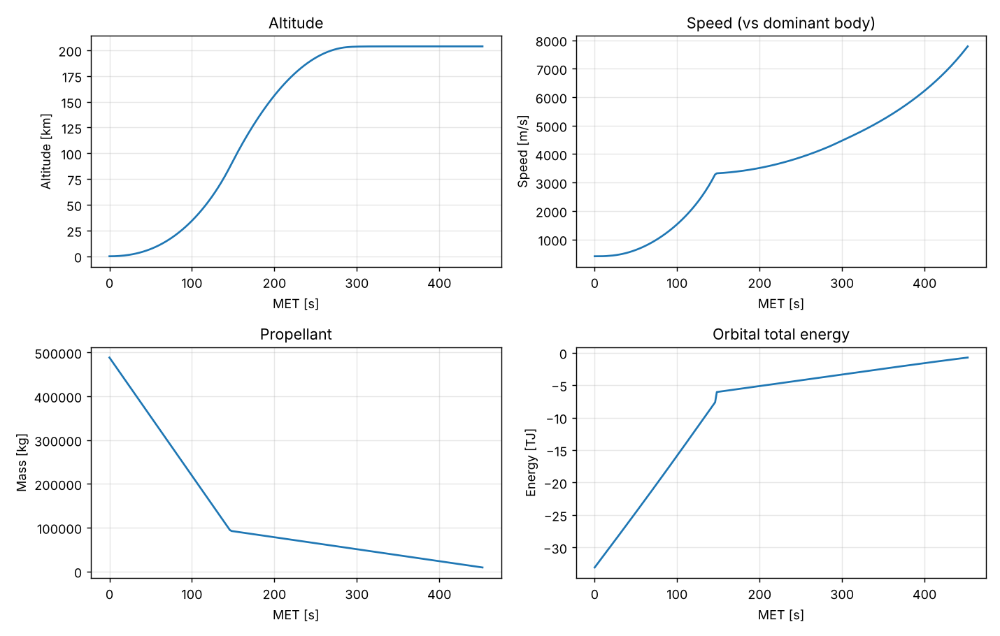

# AstraX Mission Report
Generated 2026-11-16 01:16:19 - AstraX 3.0.0-dev

**Rocket:** Falcon-class demo (illustrative)  
**Launch body:** Earth  
**Integrator:** rk4, dt mode auto (0.05 s)  
**Final status:** FLYING

## Pre-flight ESTIMATES (analytic, not simulated)
- launch_mass_kg: 5.295e+05
- mass_ratio: 34.16
- twr_sl: 1.437
- delta_v_mps: 1.083e+04
- burn_time_s: 485.3
- max_accel_ms2: 61.49
- static_margin_cal: -0.1915

## SIMULATION RESULTS
- Samples recorded: 228
- Mission elapsed time: 452.3 s
- Max altitude: 203.76 km
- Max speed (vs dominant body): 7785.3 m/s
- Max thrust acceleration: 60.69 m/s^2 (6.19 g)
- Max dynamic pressure (Max-Q): 116.28 kPa
- Delta-v spent (from mass change): 9255.5 m/s
- Propellant remaining: 9,060 kg
- Final orbit about Earth: periapsis 200.5 km, apoapsis 203.8 km, e = 0.00025

## Event log
- T+0.0 s: Initialised: Falcon-class demo (illustrative), launch from Earth, mode pad
- T+0.0 s: Phase 1: Vertical rise (fixed_local)
- T+0.0 s: LIFTOFF (T/W = 1.43)
- T+10.0 s: Phase 2: Pitch kick (pitch_program)
- T+16.1 s: Phase 3: Gravity turn (stage 1) (gravity_turn)
- T+146.7 s: STAGE SEPARATION: Stage 1 (burnout); mass now 108,170 kg
- T+146.7 s: Phase 4: Orbit insertion burn (ascent_hold)
- T+452.2 s: Phase 5: Parked in orbit (coast)

## Assumptions & limitations
- Point-mass N-body gravity; mean Keplerian initial elements (not a JPL ephemeris).
- Simplified atmosphere/drag (no lift, no winds, constant Cd). Guidance is zero-order hold per step.
- Results are NOT validated mission predictions. See docs/PHYSICS.md for the validation status.

